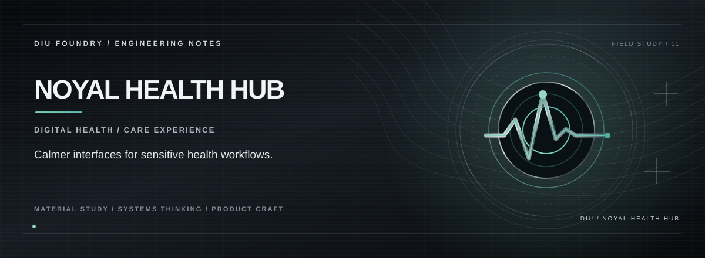

# NOYAL CABINET

**A patient-controlled health-record sharing concept centred on consent, temporary access, and clear record organisation.**

The repository is named `noyal-health-hub`; the application landing route currently brands the experience as **NoyalCabinet**. The interface explores a health-record workspace with feature sections for record organisation, temporary sharing, an AI assistant concept, hospital discovery, and access transparency.

The repository includes a Supabase integration directory, but that alone does not establish that storage, encryption, time-limited permissions, audit trails, or AI access controls are fully implemented and production-ready.

## The proposed patient journey

```text
Organise a health document
          │
          ▼
Choose what to share
          │
          ▼
Set recipient and access window
          │
          ▼
Review access and activity
          │
          ▼
Revoke / expire access
```

## Design principles

- **Patient agency:** Make sharing intent and scope visible before an action.
- **Minimum necessary access:** Prefer specific records and limited time windows over broad sharing.
- **Readable activity:** Present access history in language a patient can understand.
- **Sensitive by default:** Never assume that a polished interface is an adequate privacy or security control.

## Stack

React · TypeScript · Vite · TanStack Router / Start · Supabase client · Tailwind CSS · Motion

## Run locally

**Requirements:** Node.js and Bun (recommended).

```bash
git clone https://github.com/Kishordiu/noyal-health-hub.git
cd noyal-health-hub
bun install
bun run dev
```

Use the local URL printed by Vite.

## Health-data boundary

**Prototype only. Do not upload real medical records or personal health information to an unreviewed deployment.** Before real use, verify authentication, authorisation, storage permissions, key management, signed access links, expiry and revocation behaviour, audit-log integrity, backups, data retention, incident handling, and applicable privacy requirements. An AI health assistant must not be represented as a clinician or a validated medical decision system.

---

<p align="center"><sub>DIU FOUNDRY · PATIENT AGENCY / PRIVACY-FIRST PRODUCT DESIGN</sub></p>
